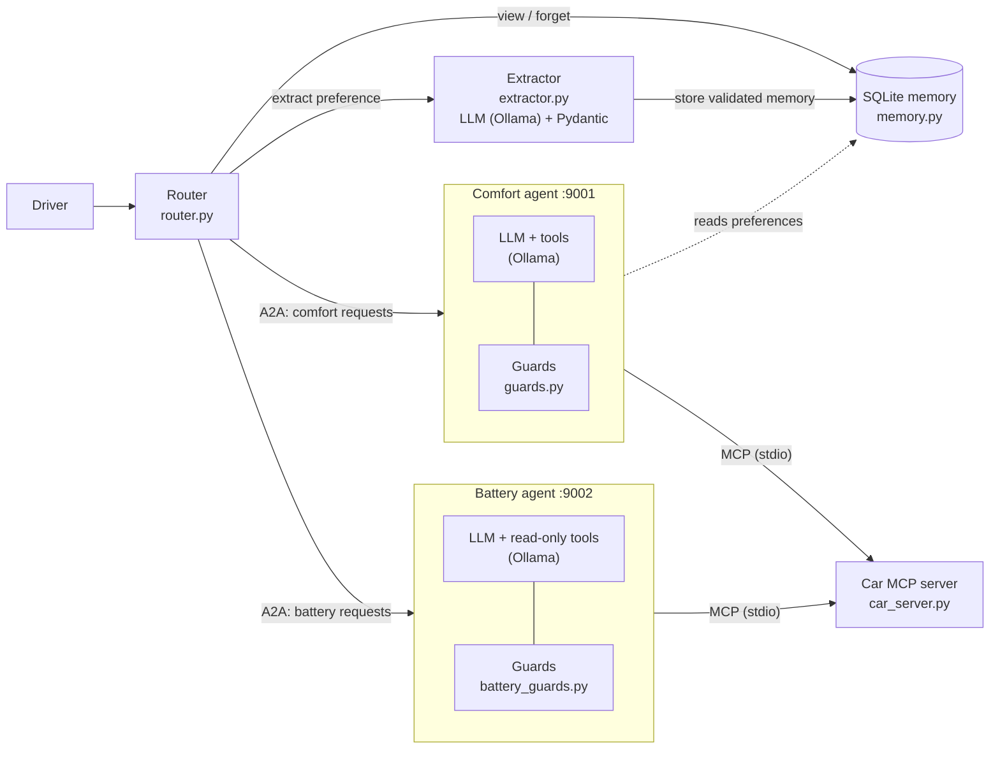

# Context-Aware In-Car Assistant

A multi-agent in-car assistant (MCP + A2A) with validated, decaying driver memory and deterministic guardrails around a small local LLM. Built to explore how to make unreliable local models safe enough to control a system. It **learns driver preferences, remembers them with confidence scores, and controls a simulated car** through MCP. Specialist agents run as separate services and talk to a router over A2A. Everything runs locally with Ollama (`llama3.1:8b`), with no API keys.

The main design idea: **the LLM proposes, code decides.** A small local model is useful but unreliable, so every action and every number in a reply passes through deterministic checks.

## Architecture



| Part                                          | What it does                                                                                                                                                              |
| --------------------------------------------- | ------------------------------------------------------------------------------------------------------------------------------------------------------------------------- |
| **Router** (`router.py`)                      | Handles memory work locally (view, forget, "I prefer ..."). Routes everything else to a specialist with a keyword rule (`pick_agent`). Keeps running if an agent is down. |
| **Comfort agent** (`comfort_agent.py`)        | A2A service. LangGraph ReAct agent for cabin temperature and media, wrapped by guards.                                                                                    |
| **Battery agent** (`battery_agent.py`)        | A2A service. LLM with read-only tools (battery, location, range estimate). A guard rejects any number the tools did not produce.                                          |
| **MCP server** (`car_server.py`)              | The simulated car: get/set temperature (range 16-28 C), battery, play media, location, plus a driver-profile resource.                                                    |
| **Memory** (`memory.py`)                      | Raw observations become derived facts per (signal, time of day) with confidence and support count.                                                                        |
| **Extractor** (`extractor.py`)                | Turns explicit chat statements ("I prefer jazz in the evening") into stored memories.                                                                                     |
| **Guards** (`guards.py`, `battery_guards.py`) | Decide which actions are allowed, repair actions the model skipped, and ensure replies only claim what really happened.                                                   |

## Memory design

- **Observed vs. stated.** Facts are inferred from simulated events (last 10 observations per signal and time of day, at least 3 needed, at least 60% agreement). Things the driver says explicitly override inferred facts.
- **Time-based decay.** Observation weight halves every 14 days, so recent behaviour wins when habits change. `derive_facts(user_id, now=...)` also expires facts whose newest observation is older than 60 days.
- **Validated extraction.** The LLM only proposes `(signal, value)`. Pydantic checks the shape, then code checks that the value appears in the message, is in the allowed range, and is a known genre. Anything else is dropped.
- **View and forget.** Say "what do you know about me" or "forget everything". Forgetting also deletes the raw observations, otherwise the fact would simply be re-derived.

## Evaluation

| Test                                                                                                | What it measures                                                                                | Result                      |
| --------------------------------------------------------------------------------------------------- | ----------------------------------------------------------------------------------------------- | --------------------------- |
| `test_memory.py`, `test_guards.py`, `test_extractor.py`, `test_battery_guards.py`, `test_router.py` | Memory logic, guards, extraction, routing (no LLM needed)                                       | all pass                    |
| `eval_extractor.py`                                                                                 | Extraction precision / recall on 13 labelled sentences (real model)                             | 100% / 100% (`llama3.1:8b`) |
| `eval_e2e.py`                                                                                       | 7 scenarios through the comfort agent, checked against the **final car state**, not the wording | 7/7                         |
| `eval_router.py`                                                                                    | 6 queries through the router and the running A2A agents (routing + correct numbers)             | 6/6                         |

Local models vary between runs, so results can differ slightly on other machines.

## Run it

```bash
python -m venv venv && source venv/bin/activate
pip install -r requirements.txt
ollama pull llama3.1:8b

python simulate.py          # replay 14 simulated days and learn the driver's habits

# three terminals
python comfort_agent.py     # :9001
python battery_agent.py     # :9002
python router.py            # chat with the assistant
```

Try: `I'm cold, play something to wake me up`, `how far can I drive?`, `I prefer jazz in the evening`, `what do you know about me`.

Tests: `./run_tests.sh` (the last parts need Ollama; `eval_router.py` needs both agents running).

## Limitations

- **A2A SDK is pinned to `a2a-sdk==0.3.25`.** The 1.x API is different (no `A2AStarletteApplication`, new `AgentCard` fields), so a port is still open.
- **All data is simulated.** One driver (`driver1`), a mock consumption model (4.5 km per percent), a mock car.
- **Routing is a keyword rule**, not a learned or LLM-based decision.
- **Conversation history is passed to agents as JSON in the message text**, not through A2A context/task IDs.
- **Fact expiry is implemented in `derive_facts(now=...)` but not wired into the live assistant**; decay weighting is always active.
- **Small local model:** it can skip a tool call or repeat one. The guards are there to catch exactly that, but they cover the cases I have seen, not all cases.
- No authentication on the A2A services; they bind to localhost only.

## Project layout

```
router.py  comfort_agent.py  battery_agent.py   # agents (A2A)
assistant.py  guards.py  battery_guards.py      # comfort logic + deterministic guards
car_server.py                                    # MCP server (the car)
memory.py  extractor.py  memory_commands.py     # memory, extraction, chat commands
signals.py  simulate.py                          # simulated driver data
test_*.py  eval_*.py  run_tests.sh               # tests and evaluation
```

## Demo

```text
$ python simulate.py
Learned profile for driver1:
  cabin_temp_set@evening       = 21          confidence 0.81 (last 10 obs)
  cabin_temp_set@morning       = 22          confidence 0.89 (last 10 obs)
  destination_set@evening      = home        confidence 1.00 (last 10 obs)
  destination_set@morning      = office      confidence 1.00 (last 10 obs)
  media_genre_played@evening   = jazz        confidence 0.80 (last 10 obs)
  media_genre_played@morning   = electronic  confidence 0.79 (last 10 obs)

$ python router.py
Connected to: Comfort Agent  skills=['Cabin comfort and media']
Connected to: Battery Agent  skills=['Battery and range']

Driver: how far can I drive?
[calls] [{'name': 'get_battery_level', 'args': {}, 'source': 'model', 'via': 'A2A:battery'}]
Assistant: The battery is at 76%, which is about 342 km of range.

Driver: I prefer jazz in the evening
[calls] [{'name': 'remember', 'args': {'signal': 'media_genre_played', 'bucket': 'evening', 'value': 'jazz', 'bucket_explicit': True}, 'source': 'router'}]
Assistant: Got it. I'll remember jazz music in the evening.

Driver: what do you know about me
[calls] [{'name': 'memory_command', 'source': 'router'}]
Assistant: Here is what I know:
- cabin temp set@evening: 21 (learned, confidence 81%)
- cabin temp set@morning: 22 (learned, confidence 89%)
- destination set@evening: home (learned, confidence 100%)
- destination set@morning: office (learned, confidence 100%)
- media genre played@evening: jazz (you told me)
- media genre played@morning: electronic (learned, confidence 79%)
```

The `via: A2A:battery` tag shows the request went through the A2A agent. "Jazz in the evening" is now `you told me`, because a stated preference overrides the learned one.
